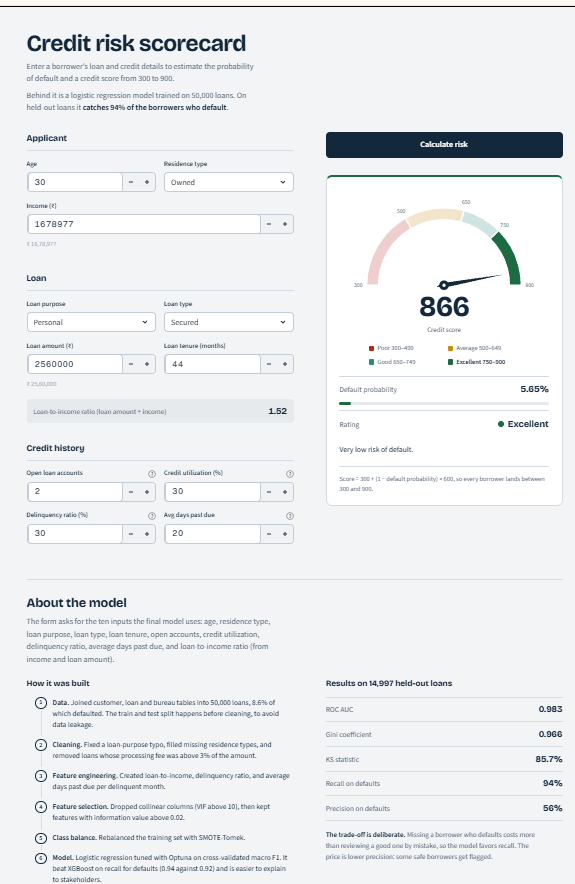
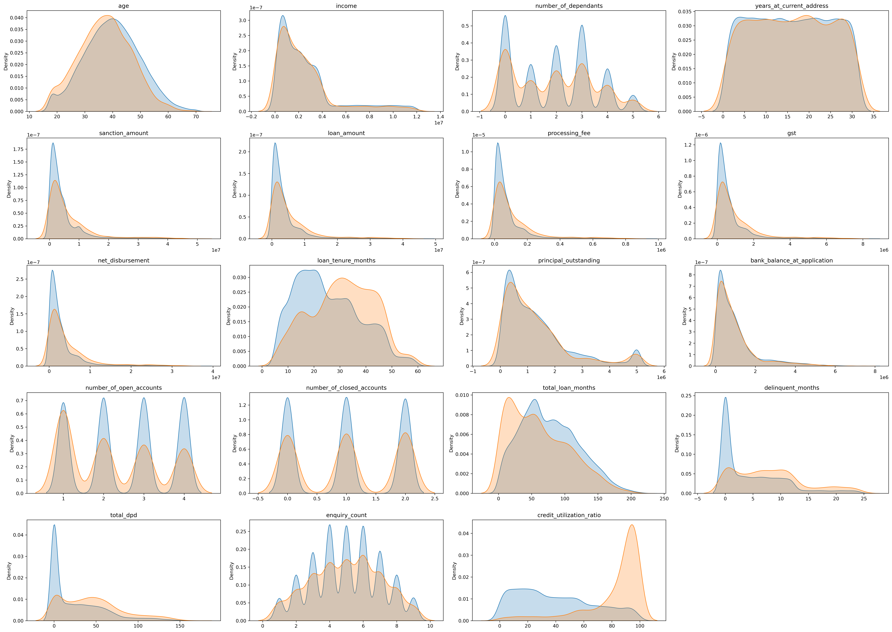
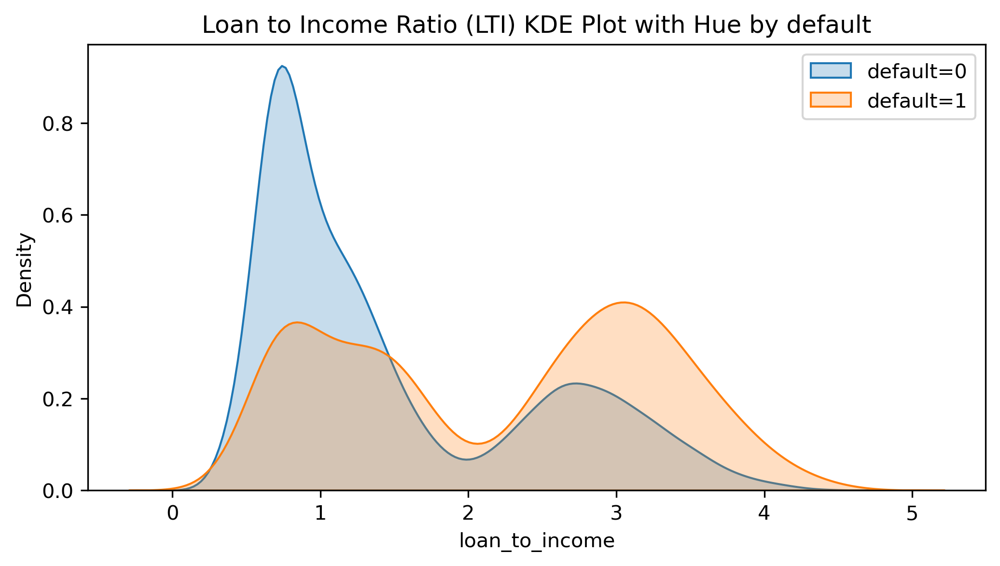
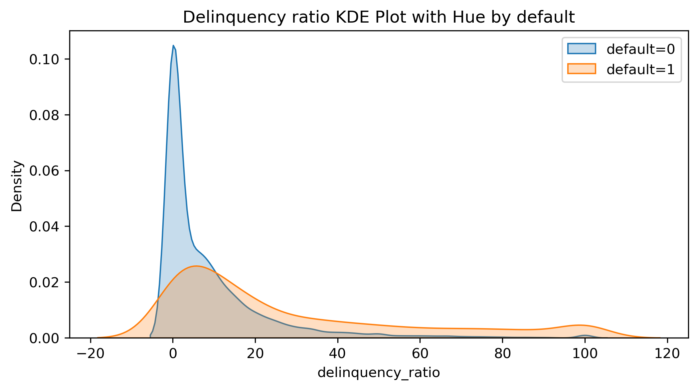
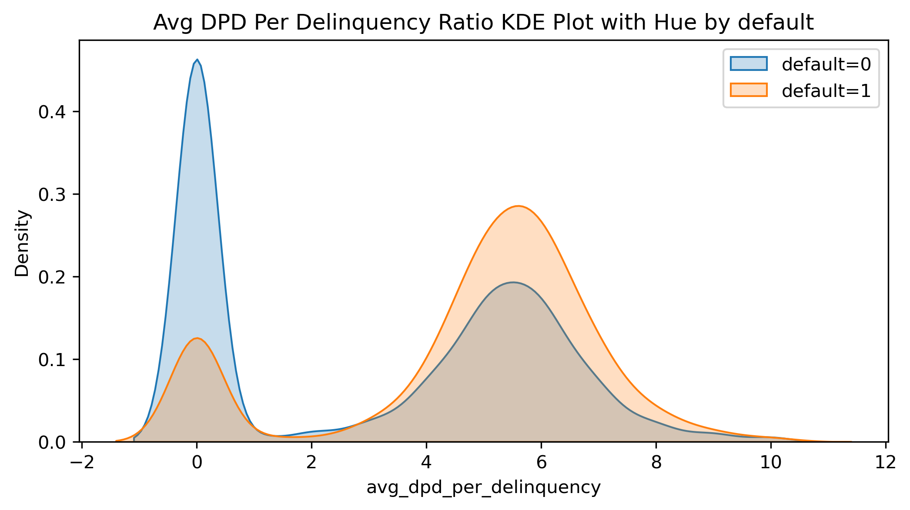
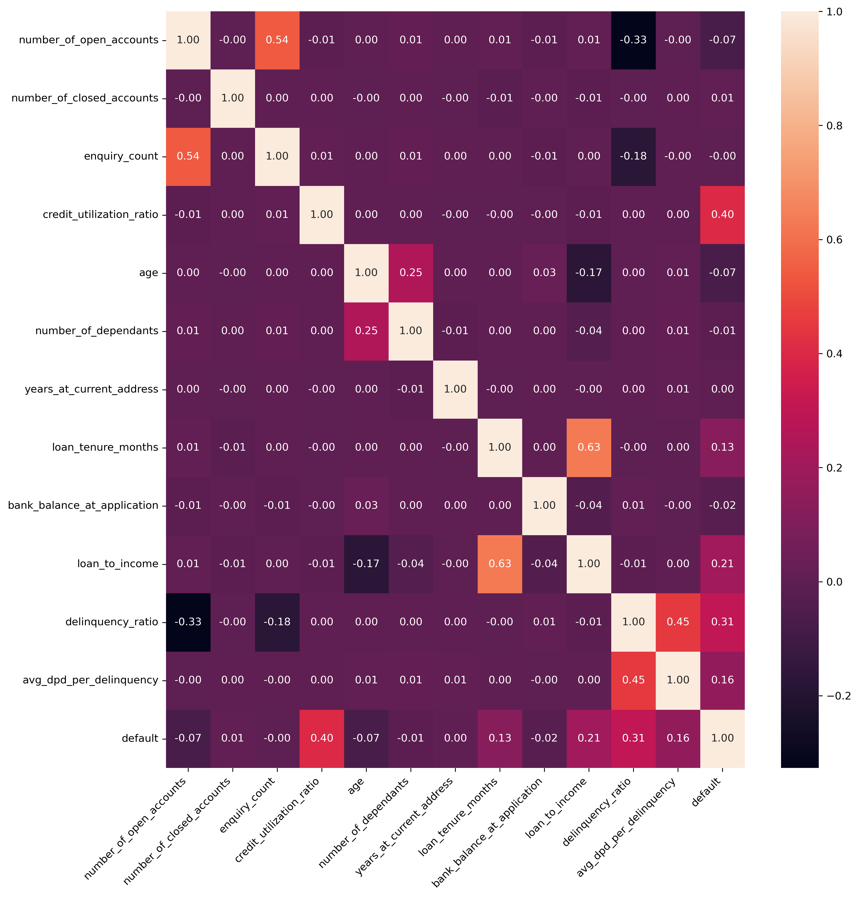
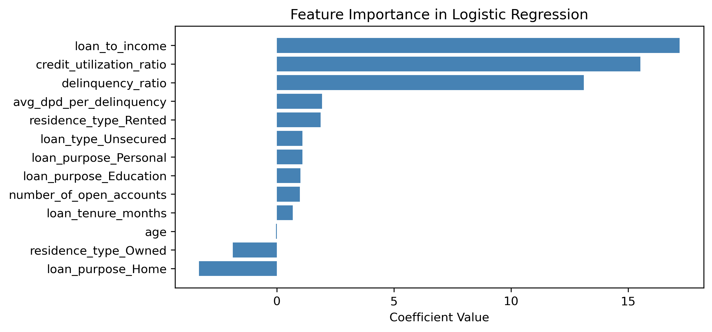
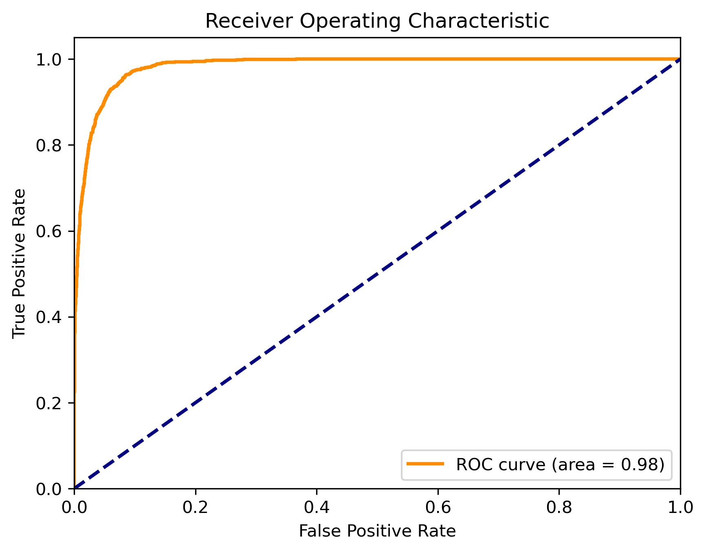

<div align="center">

# 📊 Credit Risk Scorecard

### End-to-end machine learning system that predicts loan default probability and converts it into a 300–900 credit score

[](https://www.python.org/)
[](https://scikit-learn.org/)
[](https://xgboost.readthedocs.io/)
[](https://optuna.org/)
[](https://fastapi.tiangolo.com/)
[](https://streamlit.io/)

| ROC-AUC | Gini | KS statistic | Recall on defaulters | Training data |
|:---:|:---:|:---:|:---:|:---:|
| **0.983** | **0.966** | **85.7%** | **94%** | **50,000 loans** |

<!-- 👉 SCREENSHOT #1: full-page screenshot of the Streamlit app showing a result (see "Screenshots" notes) -->


</div>

---

## 📑 Table of Contents

1. [Problem Statement](#-problem-statement)
2. [Highlights](#-highlights)
3. [Tech Stack](#-tech-stack)
4. [System Architecture](#-system-architecture)
5. [Dataset](#-dataset)
6. [Methodology: Step by Step](#-methodology-step-by-step)
7. [Results](#-results)
8. [From Probability to Credit Score](#-from-probability-to-credit-score)
9. [Web App](#-web-app-streamlit)
10. [REST API](#-rest-api)
11. [Project Structure](#-project-structure)
12. [Run It Locally](#-run-it-locally)
13. [Limitations & Future Work](#-limitations--future-work)
14. [Skills Demonstrated](#-skills-demonstrated)
15. [Author](#-author)

---

## 🎯 Problem Statement

Engineered a sophisticated credit risk model for a NBFC bank.This model builds a **credit risk model** that, given a borrower's profile, loan details and credit-bureau history:

1. estimates the **probability of default**,
2. converts it into a **credit score between 300 and 900**, and
3. assigns a **rating band**: Poor, Average, Good or Excellent.

Because **missing a defaulter is far more costly than manually reviewing a good applicant**, the model is deliberately optimised for **recall on the default class**, and is built on an **interpretable** algorithm (logistic regression) that can be explained to risk and compliance stakeholders as it is better for AI explainability and gives higher recall on th default class then the XGBoost classifier.

---

## ✨ Highlights

- **Full ML lifecycle in one repo:** data merging → cleaning → EDA → feature engineering → feature selection → imbalance handling → modelling → evaluation → deployment.
- **Leakage-aware:** the train/test split happens *before* any cleaning, and the scaler, VIF and IV are all computed on training data only.
- **Industry-standard credit-risk statistics:** VIF for multicollinearity, **Weight of Evidence / Information Value** for feature selection, and **ROC-AUC, Gini, KS and decile rank-ordering** for evaluation.
- **Seven model configurations compared:** Logistic Regression, Random Forest and XGBoost, with `RandomizedSearchCV` and **Optuna** (with a custom early-stopping callback).
- **Principled model choice:** logistic regression was chosen over XGBoost for higher default recall (0.94 vs 0.92) and explainability.
- **Two ways to use the model:** an interactive **Streamlit** scorecard and a typed **FastAPI** REST endpoint, both sharing one prediction module.

---

## 🧰 Tech Stack

| Area | Tools |
|---|---|
| Language | Python 3.12 |
| Data & analysis | pandas, NumPy, statsmodels (VIF) |
| Visualisation | Matplotlib, Seaborn |
| Modelling | scikit-learn (Logistic Regression, Random Forest), XGBoost |
| Imbalance handling | imbalanced-learn (SMOTE-Tomek) |
| Hyperparameter tuning | RandomizedSearchCV, Optuna |
| Serialisation | joblib |
| API | FastAPI, Pydantic, Uvicorn |
| Web app | Streamlit (custom CSS, SVG gauge) |
| Packaging | uv / pyproject.toml |

---

## 🏗 System Architecture

The model, scaler, feature list and scaled-column list are saved together in a single `model_data.joblib`. `prediction_helper.py` loads it once and is shared by both the Streamlit app and the FastAPI service, so **the UI and the API always return identical results**.

---

## 🗂 Dataset

Three tables, each with one row per customer, joined on `cust_id`:

| Table | Rows × Cols | What it contains |
|---|---|---|
| `customers.csv` | 50,000 × 12 | age, gender, marital status, employment, income, dependants, residence type, years at address, city, state, zipcode |
| `loans.csv` | 50,000 × 15 | loan purpose & type, sanctioned / loan amount, processing fee, GST, net disbursement, tenure, principal outstanding, bank balance, disbursal & instalment dates, **`default` (target)** |
| `bureau_data.csv` | 50,000 × 8 | open / closed accounts, total loan months, delinquent months, total days past due (DPD), enquiry count, credit utilisation ratio |

After merging: **50,000 rows × 33 columns**, with **4,297 defaults (8.6%)**, a heavily imbalanced target.


---

## 🔬 Methodology: Step by Step


### Step 1 · Load & merge

The three CSVs were inner-joined on `cust_id` into one 50,000 × 33 frame, and the boolean `default` target was cast to `int`.

### Step 2 · Train/test split *(before anything else)*

A **70/30 split** (`random_state=42`) gives **35,000 training** and **15,000 test** rows. Splitting first means no statistic from the test set (imputation values, scaling ranges, feature-selection scores) can influence training.

### Step 3 · Data cleaning

| Issue found | How it was handled |
|---|---|
| **62 missing** `residence_type` values (42 in train) | Imputed with the most frequent category (`SimpleImputer`) |
| **Duplicates** | Checked in train and test: none found |
| **Typo** `Personaal` in `loan_purpose` | Corrected to `Personal` in both sets |
| **Business-rule violations**: `processing_fee` > 3% of loan amount (e.g. a fee of ₹56.9 L on a ₹46.4 L loan) | Removed (12 train rows, 3 test rows) |
| GST ≤ 18% of loan amount; net disbursement ≤ loan amount | Validated: no violations |
| Extreme `total_dpd` (max 171) | Inspected: consistent with 24 delinquent months (~7 days avg), so **kept** as a real signal, not noise |

Outliers were examined with box plots and histograms for all 19 continuous variables.

<details>
<summary><b>📦 Click to view box plots & histograms</b></summary>
<br>

<br><br>

</details>

### Step 4 · Exploratory data analysis

KDE plots of every continuous feature, split by `default = 0 / 1`, revealed clear separation:

- 🔻 **Younger borrowers** are more likely to default.
- ⏳ **Longer loan tenure** → higher default likelihood.
- 💳 Borrowers using **close to 100% of their credit limit** default far more often.

<details>
<summary><b>📦 Click to view the full KDE grid (19 features)</b></summary>
<br>

</details>

### Step 5 · Feature engineering

Three domain-driven features were created, and the raw columns they replace were dropped (`loan_amount`, `income`, `total_loan_months`, `delinquent_months`, `total_dpd`, plus IDs and dates):

| Feature | Formula | Intuition |
|---|---|---|
| `loan_to_income` | `loan_amount / income` | How heavily is the borrower leveraged? |
| `delinquency_ratio` | `delinquent_months × 100 / total_loan_months` | What share of their credit life was spent delinquent? |
| `avg_dpd_per_delinquency` | `total_dpd / delinquent_months` (0 if none) | When they are late, how late are they? |

All three show strong separation between defaulters and non-defaulters:

<div align="center">



</div>

### Step 6 · Feature selection

**6a. Multicollinearity: Variance Inflation Factor (VIF).** Numeric features were MinMax-scaled (scaler fitted on train only) and VIF was computed. `sanction_amount` (VIF 102), `processing_fee`, `gst` and `net_disbursement` (VIF = ∞, perfectly collinear with loan size) and `principal_outstanding` (16.2) were dropped. **Every remaining feature has VIF < 10.**


<details>
<summary><b>📦 Click to view the correlation heatmap</b></summary>
<br>
<div align="center"></div>
</details>

**6b. Predictive power: Weight of Evidence (WoE) & Information Value (IV).** WoE/IV was implemented from scratch: categorical features grouped by category and numeric features binned into deciles. Only features with **IV > 0.02** were retained, reducing 20 candidates to **10 features**:

> `credit_utilization_ratio` · `delinquency_ratio` · `loan_to_income` · `avg_dpd_per_delinquency` · `loan_purpose` · `residence_type` · `loan_tenure_months` · `loan_type` · `age` · `number_of_open_accounts`

<div align="center">

</div>

Demographic fields such as gender, marital status, city and state carried almost no signal (IV ≈ 0.001), which is also a healthier outcome from a fair-lending standpoint.

### Step 7 · Scaling & encoding

Numeric features were **MinMax-scaled** (fit on train, applied to test) and categoricals **one-hot encoded** (`drop_first=True`), giving **13 final model inputs**.

### Step 8 · Handling class imbalance

With only 8.6% defaulters, baseline models over-predict the majority class. **SMOTE-Tomek** was applied **to the training set only**: SMOTE synthesises minority samples and Tomek links remove ambiguous boundary points. The result is a perfectly balanced **31,928 / 31,928** training set. The test set was left untouched so evaluation reflects the real-world distribution.

### Step 9 · Modelling: four experiments

| # | Experiment | Precision (default) | **Recall (default)** | F1 (default) | Accuracy |
|---|---|:---:|:---:|:---:|:---:|
| 1a | Logistic Regression: baseline | 0.83 | 0.70 | 0.76 | 0.96 |
| 1b | Random Forest: baseline | 0.84 | 0.71 | 0.77 | 0.96 |
| 1c | XGBoost: baseline | 0.81 | 0.74 | 0.77 | 0.96 |
| 2a | LR + SMOTE-Tomek + RandomizedSearchCV | 0.56 | **0.94** | 0.70 | 0.93 |
| 2b | XGBoost + SMOTE-Tomek + RandomizedSearchCV | 0.74 | 0.83 | 0.78 | 0.96 |
| **3** | **LR + SMOTE-Tomek + Optuna ✅ *(final)*** | **0.56** | **0.94** | **0.70** | **0.93** |
| 4 | XGBoost + SMOTE-Tomek + Optuna | 0.64 | 0.92 | 0.75 | 0.95 |


- **Optuna** searched `C`, `solver`, `tol` and `class_weight` for logistic regression (and 10 hyperparameters for XGBoost), optimising **3-fold cross-validated macro-F1**, with a **custom early-stopping callback** that halts the study after 5 trials without improvement (LR converged at trial 16, best trial 11).
- **Final model:** `LogisticRegression(C=5.77, solver='liblinear', penalty='l2')`.

### Step 10 · Why logistic regression over XGBoost?

1. **Recall is the business priority.** It catches **94%** of defaulters versus 92% for the best XGBoost.
2. **Explainability.** Coefficients map directly to risk drivers, which matters in regulated lending.
3. **Simplicity at inference.** Scoring is a dot product plus a sigmoid, with no heavy runtime dependencies.

The trade-off is explicit: precision is 0.56, so some good borrowers get flagged for review. That is an accepted cost when a missed default is more expensive than an extra manual check.

---

<div align="center">

</div>

## 📈 Results

Evaluated on **14,997 held-out loans** (1,302 defaulters).

| Metric | Value | Interpretation |
|---|:---:|---|
| **ROC-AUC** | **0.983** | Excellent separation between defaulters and non-defaulters |
| **Gini** (`2·AUC − 1`) | **0.966** | Close to a perfect discriminator |
| **KS statistic** | **85.7%** | Peaks at the 2nd-riskiest decile (≥ 40% is considered good) |
| **Recall (default)** | **0.94** | 94% of real defaulters are caught |
| **Precision (default)** | 0.56 | Deliberate trade-off for recall |
| **Accuracy** | 0.93 | |

### ROC curve

<div align="center">

</div>

### Rank ordering & KS (decile analysis)

Test customers were sorted into 10 deciles by predicted default probability. The **riskiest decile has a 72.2% actual default rate and captures 83.2% of all defaulters**; the top two deciles capture **98.2%**. Default rates fall monotonically down the deciles, which is exactly what a well-rank-ordered scorecard should do.


### What drives the prediction? (model coefficients)


The three dominant drivers (**loan-to-income, credit utilisation and delinquency ratio**) are exactly the factors a credit analyst would expect, a useful sanity check on the model.

---

## 🎚 From Probability to Credit Score

The model's default probability is converted to a familiar 300–900 scale:

```
credit_score = 300 + (1 − P(default)) × 600
```


| Score | Rating | Reading |
|---|---|---|
| 300 – 499 | 🔴 Poor | High risk of default |
| 500 – 649 | 🟠 Average | Moderate risk |
| 650 – 749 | 🟢 Good | Low risk |
| 750 – 900 | 🟢 Excellent | Very low risk |

---

## 🖥 Web App (Streamlit)

A custom-styled scorecard: grouped input form, live loan-to-income readout, animated SVG gauge needle, colour-coded rating, default-probability meter, and an "About the model" section.


**Inputs (10):** age, residence type, income, loan purpose, loan type, loan amount, loan tenure, open accounts, delinquency ratio, credit utilisation, average days past due.

**How inference works** (`prediction_helper.py`):
1. Build the engineered feature (`loan_to_income`) and one-hot flags from raw form inputs.
2. Apply the **same fitted `MinMaxScaler`** used in training.
3. Reorder columns to the exact training feature order.
4. Compute `sigmoid(X·β + b)`, then the score and rating.

> The scaler was fitted on 17 numeric columns, so the helper supplies neutral placeholder values for the 7 columns the final model doesn't use; they are dropped before scoring and have no effect on the output.

---

## 🔌 REST API

```bash
uvicorn app.main:app --reload
```

Interactive Swagger docs are served at **`http://127.0.0.1:8000/docs`**.


**Request**

```bash
curl -X POST "http://127.0.0.1:8000/predict_credit_risk" \
  -H "Content-Type: application/json" \
  -d '{
        "age": 28,
        "income": 1200000,
        "loan_amount": 2560000,
        "loan_tenure_months": 36,
        "avg_dpd_per_delinquency": 20,
        "delinquency_ratio": 30,
        "credit_utilization_ratio": 30,
        "num_open_accounts": 2,
        "residence_type": "Owned",
        "loan_purpose": "Education",
        "loan_type": "Unsecured"
      }'
```

**Response**

```json
{
  "probability": 0.6459862435127507,
  "credit_score": 512,
  "rating": "Average"
}
```

Request and response bodies are validated with **Pydantic** models (`Creditinput`, `CreditOutput`).

---

## 📁 Project Structure

```
credit-risk-model/
├── app/
│   ├── main.py                 # FastAPI service  (POST /predict_credit_risk)
│   ├── prediction_helper.py    # Feature prep + scoring, shared by API and UI
│   ├── frontend.py             # Streamlit scorecard app
│   └── artifacts/
│       └── model_data.joblib   # model + scaler + feature list + scaled-column list
├── .streamlit/
│   └── config.toml             # Light theme for the app
├── Datasets/                   # customers.csv · loans.csv · bureau_data.csv
├── assets/                     # README images
├── Credit_Risk_Model.ipynb     # Full analysis & training notebook
├── pyproject.toml
└── README.md
```

---

## ⚙️ Run It Locally

**Prerequisites:** Python 3.12+

```bash
# 1. Clone
git clone https://github.com/<your-username>/credit-risk-model.git
cd credit-risk-model

# 2. Install dependencies (pick one)
uv sync
# or
pip install -r requirements.txt

# 3a. Launch the web app
streamlit run app/frontend.py

# 3b. ...or the API
uvicorn app.main:app --reload
```

**Re-train the model:** place the three CSVs in `Datasets/`, run `Credit_Risk_Model.ipynb` top to bottom, then copy the exported `artifacts/model_data.joblib` into `app/artifacts/`.

> ⚠️ Use a `scikit-learn` version compatible with the one used for training when loading `model_data.joblib` (joblib/pickle files are version-sensitive).

---

## 🧠 Skills Demonstrated

`Data Cleaning & Validation` · `Exploratory Data Analysis` · `Feature Engineering` · `Multicollinearity (VIF)` · `Weight of Evidence / Information Value` · `Imbalanced Learning (SMOTE-Tomek)` · `Hyperparameter Optimisation (Optuna, RandomizedSearchCV)` · `Model Comparison & Selection` · `ROC-AUC / Gini / KS / Decile Analysis` · `Data-leakage Prevention` · `Model Serialisation` · `REST API Design (FastAPI + Pydantic)` · `Interactive Dashboards (Streamlit)` · `Credit-risk Domain Knowledge`

---

## 👤 Author

**Sarthak Pannu**

[](https://github.com/<your-username>)
[](https://www.linkedin.com/in/<your-profile>)

⭐ If you found this project useful, consider giving it a star!